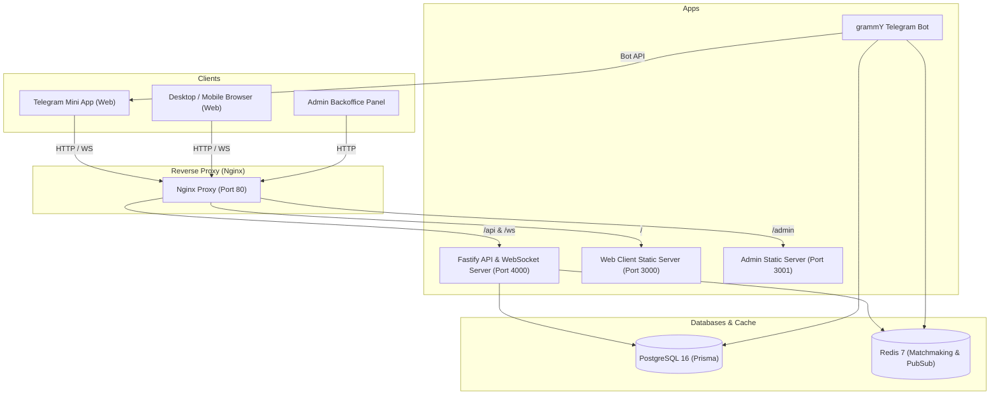

# Russian Checkers Architecture & System Design

## Overview
This platform delivers real-time Russian Checkers (*Русские шашки*) games across Web and Telegram Mini App environments.

## Packages

- **`@shashka/shared-types`**: Pure TypeScript contracts, enums, REST DTOs, and WebSocket event declarations.
- **`@shashka/validation`**: Zod validation schemas shared between frontend and backend.
- **`@shashka/config`**: Strict environment loading and typed configs.
- **`@shashka/database`**: Complete Prisma schema, migrations, and database singleton client.
- **`@shashka/game-engine`**: Complete Russian Checkers move generator, mandatory capture calculator, and flying king logic.
- **`@shashka/ui`**: React component design system.
