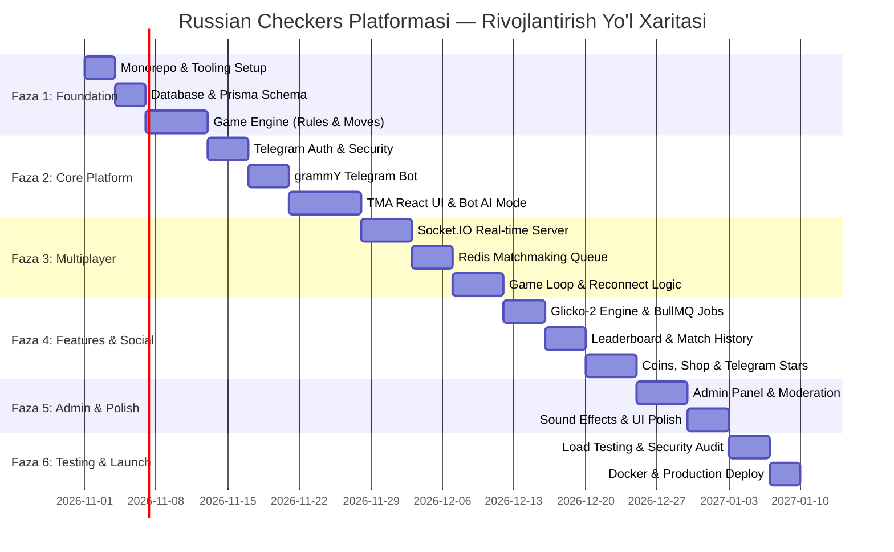

# 📅 Russian Checkers Platform — Implementation Plan

Hujjat versiyasi: `1.0.0`  
Holati: `Approved / Execution Roadmap`  
Loyiha: `shashka-game`  
Jami bosqichlar soni: `6 ta faza`  
Umumiy baholangan vaqt: `6–8 hafta (sprintlar asosida)`

---

## 1. Loyihani amalga oshirish xaritasi (Roadmap Overview)

---

## 2. Bosqichma-bosqich reja (Phased Breakdown)

---

### FAZA 1: Foundation (Infratuzilma, Ma'lumotlar bazasi va Dvigatel)
> **Asosiy maqsad**: Turborepo monorepo tuzilmasini yaratish, PostgreSQL ma'lumotlar bazasi sxemasini o'rnatish va 100% to'g'ri ishlovchi, testlar bilan qoplangan rus shashkasi sof o'yin dvigatelini (`packages/game-engine`) ishlab chiqish.

- **Bog'liqliklar**: Yo'q.
- **Baholangan muddat**: 12 ish kuni (taxminan 80-90 kishi/soat).

#### Vazifalar ro'yxati (Checklist):
- [ ] **1.1. Monorepo va Workspaces initsializatsiyasi**
  - [ ] `pnpm-workspace.yaml` va `turbo.json` konfiguratsiyalarini sozlash.
  - [ ] `packages/tsconfig` va `packages/eslint-config` umumiy paketlarini shakllantirish.
  - [ ] `apps/web`, `apps/server`, `apps/bot`, `apps/worker` va `packages/*` skeletlarini yaratish.
  - [ ] Git pre-commit hooklari (Husky, lint-staged, prettier)ni joriy qilish.
- [ ] **1.2. Ma'lumotlar bazasi va Prisma arxitekturasi (`packages/database`)**
  - [ ] `schema.prisma` faylida barcha modellarni (`User`, `UserStats`, `Game`, `GameMove`, `Item`, `UserInventory`, `Friendship`, `Transaction`) yaratish.
  - [ ] Indekslarni qo'shish (masalan: `telegramId`, `rating`, `createdAt` maydonlari uchun tezkor indekslar).
  - [ ] Dastlabki SQL migratsiyasini hosil qilish (`prisma migrate dev`).
  - [ ] Boshlang'ich kosmetik tovarlar va skinlar uchun Seed skriptini yozish (`seed.ts`).
- [ ] **1.3. Rus shashkasi sof o'yin dvigateli (`packages/game-engine`)**
  - [ ] Doska reprezentatsiyasi (8x8 massiv yoki 32-bit Bitboard tuzilmasi).
  - [ ] Oddiy toshlar harakati va zarbasi logikasi (oldinga yurish, oldinga va orqaga urish).
  - [ ] Damka harakati va uzoq masofali uchar damka zarbasi logikasi.
  - [ ] Majburiy urish qoidasi (`isCaptureMandatory`) va ketma-ket bir nechta toshni urish zanjiri (Capture combos).
  - [ ] Yurish davomida damkaga aylanish va o'sha navbatda damka sifatida urishni davom ettirish logikasi.
  - [ ] Turkcha zarba taqiqi (bitta seriyada bir toshni ikki marta urmaslik).
  - [ ] Qonuniy yurishlar generatori (`getLegalMoves(board, turn)`).
  - [ ] Shashka klassik notatsiyasi parsiri (`c3-d4`, `a3:c5:e7`).
  - [ ] Vitest orqali qoidalar bo'yicha to'liq Unit testlar yozish (Kamida 50+ test holatlari: pat, mat, seriyali urish, damkaga o'tish).

---

### FAZA 2: Core Platform (Autentifikatsiya, Bot va Asosiy UI)
> **Asosiy maqsad**: Telegram WebApp initData orqali xavfsiz tizimga kirishni yo'lga qo'yish, grammY botini sozlash hamda TMA da botga va oflayn do'stga qarshi o'ynash mumkin bo'lgan interfeysni yaratish.

- **Bog'liqliklar**: Faza 1 (Game Engine va Database tayyor bo'lishi shart).
- **Baholangan muddat**: 15 ish kuni (taxminan 100-110 kishi/soat).

#### Vazifalar ro'yxati (Checklist):
- [ ] **2.1. Telegram Autentifikatsiyasi (`apps/server`)**
  - [ ] Telegram `initData` ni HMAC-SHA256 algoritmi orqali tekshiruvchi Fastify plaginini yozish.
  - [ ] Eskirgan ma'lumotlar (`auth_date` > 24 soat) va soxta hash'larni rad etuvchi middleware.
  - [ ] Foydalanuvchini ro'yxatdan o'tkazish yoki mavjud profilini sinxronlash (Upsert).
  - [ ] Xavfsiz JWT (JsonWebToken) generatsiyasi va avtorizatsiya guardlari.
- [ ] **2.2. grammY Telegram Botini ishga tushirish (`apps/bot`)**
  - [ ] `/start` komandasi: mini app tugmasi (MenuButton va InlineButton WebApp) bilan xush kelibsiz xabari.
  - [ ] `/play` komandasi: to'g'ridan-to'g'ri o'yinni boshlash havolasi.
  - [ ] `/stats` komandasi: o'yinchining joriy reytingi, g'alabalari va unvoni haqida qisqacha xabar.
  - [ ] `/leaderboard` komandasi: Top 10 o'yinchilar ro'yxati.
  - [ ] Do'st taklif havolalari (Deep linking: `t.me/bot?startapp=invite_CODE`).
- [ ] **2.3. Telegram Mini App (TMA) Frontend (`apps/web`)**
  - [ ] Vite + React + TypeScript + Tailwind CSS loyihasini Telegram WebApp SDK bilan integratsiya qilish.
  - [ ] Telegram mavzulari (Dark / Light mode) va xavfsiz hudud (Viewport/SafeArea) moslashuvi.
  - [ ] Interaktiv 8x8 shashka doskasi komponenti (`Board.tsx`, `Square.tsx`, `Piece.tsx`).
  - [ ] Toshni bosish va harakatlantirish (Click-to-move va Drag-and-drop) qobiliyati.
  - [ ] Mumkin bo'lgan yurish kataklarini yashil rangda, majburiy urish toshlarini qizil ramkada ta'kidlash (Highlight).
  - [ ] Toshlarni urish animatsiyalari va damkaga aylanish vizual effekti.
- [ ] **2.4. Sun'iy intellekt (Bot AI) va Oflayn rejim**
  - [ ] Minimax + Alpha-Beta algoritmini Web Worker ichida ishga tushirish (UI qotib qolmasligi uchun).
  - [ ] 3 xil qiyinlik darajasi (Easy: tasodifiy zarbalar, Medium: 4-ply, Hard: 6-ply).
  - [ ] Bitta telefonda ikki kishi o'ynaydigan oflayn rejim (Pass and Play).

---

### FAZA 3: Real-Time Multiplayer (Tarmoq, Matchmaking va Reconnection)
> **Asosiy maqsad**: Socket.IO va Redis yordamida o'yinchilarni real vaqtda bir-biri bilan juftlashtirish, harakatlarni kechikishsiz almashish hamda uzilgan aloqani avtomatik tiklash mexanizmini yaratish.

- **Bog'liqliklar**: Faza 2 (Auth va Frontend doska komponenti).
- **Baholangan muddat**: 14 ish kuni (taxminan 95-105 kishi/soat).

#### Vazifalar ro'yxati (Checklist):
- [ ] **3.1. Socket.IO Gateway va Autentifikatsiya**
  - [ ] Fastify ichida Socket.IO serverini ko'tarish va JWT handshake middleware sozlash.
  - [ ] Foydalanuvchi uzilganda va ulanganda xona boshqaruvi (`user:${userId}`).
  - [ ] Redis Adapter (`@socket.io/redis-adapter`) orqali xabarlarni klasterlash.
- [ ] **3.2. Redis asosidagi Matchmaking tizimi**
  - [ ] Vaqt rejimlari bo'yicha navbatlar: Blitz (3+2), Rapid (5+3), Classic (10+0).
  - [ ] O'yinchilarni Glicko-2 reytingi bo'yicha saralash va juftlash algoritmi.
  - [ ] Har 3 soniyada qidiruv oralig'ini kengaytirish (masalan: $\pm 100 \rightarrow \pm 200 \rightarrow \pm 400$).
  - [ ] Xususiy xonalar (Private Rooms) yaratish va invite token orqali do'stni kutish tizimi.
- [ ] **3.3. Real-Time O'yin tsikli (Game Loop) va Vaqt boshqaruvi**
  - [ ] O'yin xonasi (`game:${gameId}`) yaratilishi va ikkala o'yinchiga ranglar taqsimlanishi.
  - [ ] `game:move` hodisasi: har bir yurish serverda `packages/game-engine` orqali tekshirilishi.
  - [ ] Server nazoratidagi Fischer taymeri (aniq millisekundlarda hisoblash, vaqt tugaganda avtomatik texnik mag'lubiyat).
  - [ ] Durang taklif qilish (`game:offer_draw`), qabul qilish va taslim bo'lish (`game:resign`).
- [ ] **3.4. Tarmoq uzilishi va Qayta ulanish (Disconnect & Grace Period)**
  - [ ] O'yinchi aloqadan uzilganda 45 soniyalik qayta ulanish taymerini ishga tushirish.
  - [ ] Raqibga "Raqib aloqasi uzildi, kutilyapti..." statusini ko'rsatish.
  - [ ] O'yinchi qayta ulanganda (`game:reconnect`), doskaning so'nggi holati va qolgan vaqtni sinxronlashtirish.
  - [ ] 45 soniyadan keyin ulanmasa, "Abandonment" bo'yicha g'alabani ikkinchi o'yinchiga berish.

---

### FAZA 4: Features & Social (Reyting, Do'kon va Iqtisodiyot)
> **Asosiy maqsad**: Glicko-2 reytingini o'yin yakunida qayta hisoblash, BullMQ asinxron ishlovchisi, peshqadamlar jadvali, profil tarixi hamda virtual tangalar va kosmetik do'kon tizimini joriy etish.

- **Bog'liqliklar**: Faza 3 (Real-time o'yinlar yakunlanishi voqealari).
- **Baholangan muddat**: 13 ish kuni (taxminan 85-95 kishi/soat).

#### Vazifalar ro'yxati (Checklist):
- [ ] **4.1. Glicko-2 hisoblash va BullMQ Worker**
  - [ ] O'yin tugashi bilan BullMQ navbatiga `process-game-result` topshirig'ini yuborish.
  - [ ] Workerda Glicko-2 algoritmi bo'yicha o'yinchilarning yangi $R$, $RD$ va $\sigma$ qiymatlarini hisoblash.
  - [ ] O'zgarishlarni `RatingHistory` va `UserStats` jadvallariga tranzaksiya bilan yozish.
  - [ ] O'yinchilar g'alaba seriyasi (Win streak) va unvonlarini yangilash.
- [ ] **4.2. Peshqadamlar jadvali va O'yinlar tarixi**
  - [ ] Global Leaderboard API (Haftalik, Oylik, Barcha davrlar).
  - [ ] Redis Sorted Sets (`ZADD`, `ZREVRANGE`) yordamida peshqadamlar ro'yxatini keshlash.
  - [ ] Foydalanuvchi profilida o'tkazilgan o'yinlar arxivi va har bir o'yinning to'liq yurishlar notatsiyasini qayta ko'rish (Match Replay).
- [ ] **4.3. Virtual iqtisodiyot va Do'kon (Shop & Currency)**
  - [ ] O'yinda g'alaba qozonganda tangalar berish mexanizmi.
  - [ ] Kunlik kirish bonusi (Daily Reward Streak: 1-kundan 7-kungacha).
  - [ ] Do'kon katalogi: Doska skinlari (yog'och, kiberpank, marmar) va toshlar dizayni.
  - [ ] Skin sotib olish va kiyish (`equip`) mexanizmi.
  - [ ] Telegram Stars orqali eksklyuziv to'lovlarni qabul qilish integratsiyasi.

---

### FAZA 5: Admin Panel, Moderatsiya va Polishing
> **Asosiy maqsad**: Tizim ma'muri uchun boshqaruv panelini yaratish, firibgarlikka (cheat) qarshi tahlil vositalarini qo'shish, ovoz va animatsiyalarni mukammallashtirish.

- **Bog'liqliklar**: Faza 4.
- **Baholangan muddat**: 9 ish kuni (taxminan 60-70 kishi/soat).

#### Vazifalar ro'yxati (Checklist):
- [ ] **5.1. Admin Paneli (Admin Dashboard)**
  - [ ] Admin autentifikatsiyasi va RBAC ruxsatlari.
  - [ ] Jonli o'yinlar monitoringi (faol o'yinlar soni, onlayn foydalanuvchilar).
  - [ ] Foydalanuvchilarni qidirish, statistikasini ko'rish, hisobini bloklash (Ban/Unban).
  - [ ] Noto'g'ri hisoblangan o'yinlar bo'yicha apellyatsiyalarni ko'rib chiqish.
- [ ] **5.2. Cheat tahlili (Anti-Cheat Move Profiling)**
  - [ ] Har bir yurishga sarflangan vaqt telemetriyasi (`timeSpentMs`).
  - [ ] Doimiy ravishda 2-3 soniyada dvigatel darajasidagi 100% ideal yurishlarni amalga oshiruvchi o'yinchilarni avtomatik `suspicious` deb belgilash.
- [ ] **5.3. Tovushlar, Haptics va UI Polishing**
  - [ ] Telegram Haptic Feedback (vibratsiya) integratsiyasi: tosh surilganda, urilganda, o'yin yutilganda.
  - [ ] O'yin tovush effektlari (Web Audio API: move sound, capture click, timer ticking, victory fanfare).
  - [ ] O'yin ichida tezkor kulgili reaksiyalar (Animated Emoji reactions).

---

### FAZA 6: Testing, CI/CD va Production Deployment
> **Asosiy maqsad**: To'liq yuklama ostida sinovlar, xavfsizlik auditi, konteynerlarni yig'ish va loyihani jonli ishlab chiqarish serveriga xatolarsiz joylashtirish.

- **Bog'liqliklar**: Barcha oldingi fazalar.
- **Baholangan muddat**: 7 ish kuni (taxminan 50 kishi/soat).

#### Vazifalar ro'yxati (Checklist):
- [ ] **6.1. Sinovlar va Sifat nazorati (Testing & QA)**
  - [ ] `packages/game-engine` qamrovini 95%+ darajaga yetkazish.
  - [ ] Playwright orqali E2E (End-to-End) sinovlari: mini app ochilishi, bot bilan partiya yakunlanishi.
  - [ ] Artillery yoki k6 yordamida WebSocket yuklama testi (bir vaqtda 5,000+ aktiv WebSocket ulanishlarini sinash).
- [ ] **6.2. CI/CD Pipeline (GitHub Actions)**
  - [ ] Har bir Pull Request uchun avtomatik Lint, Typecheck va Test jarayoni.
  - [ ] Docker imagelarni qurish va Docker Hub / GitHub Container Registry'ga yuklash.
- [ ] **6.3. Ishlab chiqarishga joylashtirish (Production Launch)**
  - [ ] Linux Ubuntu serverini tayyorlash (Docker, Nginx, UFW Firewall).
  - [ ] SSL sertifikatlarini (Let's Encrypt / Certbot) o'rnatish.
  - [ ] PostgreSQL va Redis zaxira nusxalarini (Automated Daily Backups) yo'lga qo'yish.
  - [ ] Telegram Bot webhookini rasmiy domenga bog'lash.
  - [ ] Jonli monitoring (Uptime Kuma, Prometheus/Grafana yoki Docker loglar)ni ishga tushirish.

---

## 3. Resurslar, Mehnat sarfi va Xavflarni boshqarish (Risk Management)

### 3.1. Mehnat sarfi xulosasi
| Faza | Nomi | Davomiyligi | Kishi/Soat |
| :--- | :--- | :--- | :--- |
| **Faza 1** | Foundation (Monorepo, DB, Game Engine) | 12 kun | 85h |
| **Faza 2** | Core Platform (Auth, Bot, UI, Offline) | 15 kun | 105h |
| **Faza 3** | Multiplayer (Sockets, Matchmaking, Reconnect) | 14 kun | 100h |
| **Faza 4** | Features (Glicko-2, Stats, History, Shop) | 13 kun | 90h |
| **Faza 5** | Admin, Anti-Cheat, UI Polish | 9 kun | 65h |
| **Faza 6** | Testing, CI/CD, Deployment | 7 kun | 50h |
| **JAMI** | **To'liq ishlab chiqish sikli** | **~70 ish kuni** | **~495 kishi/soat** |

### 3.2. Ehtimoliy xavflar va ularni yumshatish (Risks & Mitigation)

| Xavf / Muammo | Ehtimollik | Ta'siri | Yumshatish strategiyasi (Mitigation) |
| :--- | :--- | :--- | :--- |
| **Mobil tarmoqning beqarorligi (Packet Loss / Lag)** | Yuqori | Yuqori | WebSocket ulanishi uzilganda 45s grace period, mijozda lokal optimistik render, serverdan to'liq holatni qayta sinxronlash (`game:state_sync`). |
| **Telegram initData soxtalashtirilishi** | O'rta | Kritik | Bot tokeni faqat server `.env` da saqlanadi, har bir so'rov HMAC-SHA256 bilan tekshiriladi, 24 soatdan oshgan tokenlar qat'iy rad etiladi. |
| **Shashka qoidalaridagi nozik holatlar (Turkcha zarba, Damkaga o'tish)** | O'rta | Yuqori | Xalqaro IDF qoidalari bo'yicha 50 dan ortiq tayyor shashka vaziyatlari asosida keng qamrovli Unit testlar to'plamini tuzish. |
| **Server yuklamasi o'sishi (Multiplayer Spikes)** | O'rta | Yuqori | Socket.IO Redis adapter orqali bir nechta Fastify instansiyalariga yuklamani taqsimlash, Redis Sorted Sets orqali tezkor navbat boshqaruvi. |
