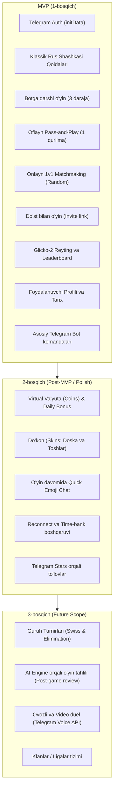

# 📋 Russian Checkers (Rus Shashkasi) — Product Specification

Hujjat versiyasi: `1.0.0`  
Holati: `Approved / Production-Ready`  
Loyiha kodi: `shashka-game`  
Asosiy texnologiyalar: `Telegram Mini App (TMA)`, `React`, `TypeScript`, `Fastify`, `Socket.IO`, `PostgreSQL`

---

## 1. Loyiha haqida umumiy ma'lumot (Project Overview & Vision)

### 1.1. Kirish
**Russian Checkers (Rus shashkasi)** — bu Telegram messenjeri ekotizimida ishlovchi, real vaqt rejimida (real-time multiplayer) va oflayn rejimda o'ynash imkonini beruvchi zamonaviy Telegram Mini App (TMA) o'yin platformasidir.

Loyiha foydalanuvchilarga hech qanday qo'shimcha ilova o'rnatmasdan (zero-install), bevosita Telegram ichida do'stlari yoki tasodifiy raqiblar bilan klassik rus shashkasi qoidalari asosida raqobatlashish, sun'iy intellekt (bot) bilan mashq qilish, Glicko-2 reyting tizimi bo'yicha global peshqadamlar ro'yxatida ko'tarilish hamda shaxsiy profil va inventarni rivojlantirish imkoniyatini taqdim etadi.

### 1.2. Asosiy maqsadlar (Strategic Goals)
1. **Seamless User Experience**: Telegram foydalanuvchisi bot orqali bir marta bosish bilan to'liq ekranli Mini App'ga kiradi va 3 soniya ichida o'yinni boshlay oladi.
2. **Haqiqiy raqobat va adolatli reyting (Fair Play & Competitive Ranking)**: Shaxmat va shashka sportida xalqaro standart hisoblangan Glicko-2 reyting tizimi orqali har bir o'yinchining haqiqiy mahorat darajasini (Skill rating) aniq hisoblash.
3. **Real-time barqarorlik (Ultra-low Latency)**: WebSocket (Socket.IO) orqali yurishlarni minimal kechikish (<50ms) bilan sinxronlashtirish va tarmoq uzilganda avtomatik qayta ulanish (reconnection with state recovery).
4. **Viral o'sish mexanizmlari (Social & Viral Mechanics)**: Telegram guruhlari va chatlariga do'stlarni o'yinga chorlovchi taklif havolalari (Direct Invite Links), o'yin natijalari bilan bo'lishish (Share Match Results) va referal dasturi.
5. **Monetizatsiya va virtual iqtisodiyot**: Telegram Stars va virtual tangalar (Coins) orqali doska va toshlar dizaynini (skins/customization) xarid qilish imkoniyati.

---

## 2. Maqsadli auditoriya va Foydalanuvchi personalari (Target Audience & Personas)

### 2.1. Auditoriya segmentlari
- **MDH va O'zbekiston Telegram auditoriyasi**: Rus shashkasi an'anaviy ravishda ommabop bo'lgan 14–55 yosh oralig'idagi o'yinchilar.
- **Casual Gamers**: Metroda, tushlik vaqtida yoki do'stini kutayotganda 3-5 daqiqalik tezkor aqliy o'yin xohlovchilar.
- **Competitive Enthusiasts**: Shashka ixlosmandlari, o'z reytingini ko'tarish, peshqadamlar jadvalida yuqori o'rinlarni egallash va o'z o'yinlarini tahlil qilishni xohlovchilar.

### 2.2. Foydalanuvchi personalari (User Personas)

| Persona | Ism / Rol | Tavsif | Asosiy ehtiyoji |
| :--- | :--- | :--- | :--- |
| **Persona 1: Casual Player** | Aziz (22 yosh, talaba) | Telegramdan kun bo'yi foydalanadi, o'yin yuklab olishni yoqtirmaydi. | Tezkor (3 daqiqalik blitz) o'yin topish, zerikishni ketkazish. |
| **Persona 2: Competitive Player** | Rustam aka (41 yosh, shashka havaskori) | Shashka taktikalarini yaxshi biladi, jiddiy raqiblarni qidiradi. | Aniq reyting tizimi, adolatli hakamlik (cheat bo'lmasligi), xatolarsiz qoidalar. |
| **Persona 3: Social Player** | Nilufar (26 yosh, ofis xodimi) | Hamkasbi bilan o'zaro kim kuchli ekanligini sinashni xohlaydi. | Telegram chatga link tashlab darhol o'yin boshlash, chatda kulgili reaksiyalar yuborish. |
| **Persona 4: Platform Admin** | Administrator / Moderator | Tizim sog'lomligi, firibgarlik (anti-cheat) va foydalanuvchilar oqimini nazorat qiladi. | Foydalanuvchilarni boshqarish, o'yin statistikasi, ban tizimi. |

---

## 3. Funksional xususiyatlar: MVP va Kelajak rejalari (Feature List)



### 3.1. MVP funksiyalari (Minimal Yaroqli Mahsulot)
- **Telegram Native Auth**: Telegram Mini App orqali foydalanuvchini avtomatik ro'yxatdan o'tkazish va sessiyani xavfsiz boshlash.
- **To'liq Rus shashkasi qoidalari**: Majburiy urish (orqaga ham), ketma-ket bir nechta toshni urish, uchar damka (flying king), yurish davomida damkaga aylanish.
- **O'yin rejimlari**:
  - *Bot bilan o'yin*: Oson (Easy), O'rta (Medium), Qiyin (Hard).
  - *Oflayn 2 o'yinchi*: Bitta telefonda ikki kishi navbat bilan o'ynashi.
  - *Onlayn 1v1 Matchmaking*: Tasodifiy teng kuchli raqib topish.
  - *Do'st bilan o'ynash*: Telegram orqali xususiy xona havolasi yaratish.
- **Vaqt nazorati (Time Controls)**:
  - Blitz: 3 daqiqa + 2 soniya qo'shimcha (har bir yurish uchun).
  - Rapid: 5 daqiqa + 3 soniya qo'shimcha.
  - Classic: 10 daqiqa (qo'shimchasiz).
- **Glicko-2 reytingi**: Har bir onlayn o'yindan so'ng reyting va noaniqlik ko'rsatkichi (RD) qayta hisoblanishi.
- **Profil va Statistika**: Jami o'yinlar, g'alabalar, duranglar, mag'lubiyatlar, g'alaba foizi (Winrate), joriy reyting.
- **Telegram Bot funksiyalari**: `/start`, `/play`, `/stats`, `/leaderboard`, `/help`.

---

## 4. Foydalanuvchi ssenariylari (User Stories & Acceptance Criteria)

### US-01: Telegram orqali o'yinga kirish (Seamless Authentication)
- **As a** Telegram foydalanuvchisi,
- **I want to** Mini App havolasini bosganda login yoki parol kiritmasdan o'yinga kirishni,
- **So that** ortiqcha qadamlarsiz darhol o'ynashni boshlashim mumkin bo'lsin.
- **Acceptance Criteria**:
  - *Given*: Foydalanuvchi botdagi "Play Shashka" tugmasini bosadi.
  - *When*: Mini App ochiladi va `Telegram.WebApp.initData` serverga yuboriladi.
  - *Then*: Server Telegram HMAC imzosini tekshiradi, agar yangi foydalanuvchi bo'lsa DB da yaratadi, mavjud bo'lsa profili va reytingini qaytaradi va foydalanuvchi Bosh sahifani (Lobby) ko'radi.

### US-02: Tezkor onlayn raqib qidirish (Quick Matchmaking)
- **As a** o'yinchi,
- **I want to** "Tezkor o'yin" tugmasini bosib o'zimga mos darajadagi raqib bilan to'qnashishni,
- **So that** uzoq kutmasdan raqobatli o'yin o'tkazishim mumkin bo'lsin.
- **Acceptance Criteria**:
  - *Given*: Foydalanuvchi vaqt nazoratini (masalan, 3m+2s) tanlaydi va "Find Match" bosadi.
  - *When*: Foydalanuvchi qidiruv navbatiga (Redis Queue) qo'shiladi. Tizim Glicko-2 reytingi $\pm 100$ oralig'idagi boshqa o'yinchini qidiradi.
  - *Then*: Agar 15 soniya ichida topilmasa, qidiruv diapazoni $\pm 250$ gacha kengaytiriladi; raqib topilgach, ikkala o'yinchi `game:start` voqeasini oladi va doska paydo bo'ladi.

### US-03: Bot bilan mashg'ulot o'tkazish (Single Player AI)
- **As a** yangi o'yinchi,
- **I want to** internetsiz yoki tajriba oshirish uchun turli darajadagi botlarga qarshi o'ynashni,
- **So that** o'z mahoratimni xavf-xatarsiz (reyting tushirmasdan) charxlashim mumkin bo'lsin.
- **Acceptance Criteria**:
  - *Given*: Foydalanuvchi "Play with Bot" bo'limida "Medium" darajasini tanlaydi.
  - *When*: O'yin boshlanadi. Foydalanuvchi o'z yurishini qiladi.
  - *Then*: Bot 400-800ms o'ylash vaqti imitatsiyasi bilan qoidalarga to'liq mos eng yaxshi yurishni javoban amalga oshiradi. O'yin natijasi Glicko-2 reytingiga ta'sir qilmaydi.

### US-04: Do'st bilan shaxsiy xona orqali o'ynash (Private Room)
- **As a** do'stim bilan o'ynamoqchi bo'lgan foydalanuvchi,
- **I want to** o'yin xonasi yaratib, taklif linkini Telegram chatga yuborishni,
- **So that** faqat do'stim kirib men bilan o'ynay olsin.
- **Acceptance Criteria**:
  - *Given*: Foydalanuvchi "Do'st bilan o'ynash" tugmasini bosadi va vaqt rejimini tanlaydi.
  - *When*: Server noyob `roomCode` generatsiya qiladi va Telegram Share Sheet orqali havola taqdim etadi (`https://t.me/shashka_game_bot?startapp=room_XYZ123`).
  - *Then*: Do'sti linkni bosganida to'g'ridan-to'g'ri o'sha xonaga ulanadi va ikkala o'yinchi tayyor bo'lishi bilan partiya boshlanadi.

### US-05: Shashka yurishini amalga oshirish va qoidalarning majburiyligi
- **As a** partiyadagi o'yinchi,
- **I want to** o'z navbatim kelganda qoidalarga muvofiq toshni surish yoki raqib toshini urishni,
- **So that** o'yin halol va rasmiy qoidalarga muvofiq davom etsin.
- **Acceptance Criteria**:
  - *Given*: O'yinchining toshlaridan birida raqib toshini urish (zarba) imkoniyati mavjud.
  - *When*: O'yinchi urish imkoni bo'lmagan boshqa toshni oddiy surmoqchi bo'ladi.
  - *Then*: Tizim bu yurishni taqiqlaydi, doskada faqat urishi shart bo'lgan toshlarni yoritib (highlight) ko'rsatadi, chunki rus shashkasida urish MAJBURIY!

### US-06: Aloqa uzilishi va qayta ulanish (Disconnect & Reconnect)
- **As a** mobil internetda o'ynayotgan foydalanuvchi,
- **I want to** tarmoq uzilib qolib qayta ulanganda o'yinim saqlanib qolishini,
- **So that** tasodifiy tarmoq nosozligi tufayli texnik mag'lubiyatga uchramay.
- **Acceptance Criteria**:
  - *Given*: O'yinchi onlayn partiya o'ynamoqda va to'satdan internet o'chadi.
  - *When*: Server WebSocket uzilishini qayd etadi va 45 soniyalik qayta ulanish taymerini (Grace period) ishga tushiradi. Raqibga "Raqib qayta ulanmoqda..." xabari ko'rinadi.
  - *Then*: Agar o'yinchi 45 soniya ichida qaytsa, doskaning so'nggi holati qayta yuklanadi va o'yin davom etadi. Agar 45 soniyada ulanmasa, o'yinchiga "Abandonment Loss" yoziladi.

---

## 5. Rus shashkasi rasmiy qoidalari (Official Russian Checkers Rules Specification)

Ushbu platforma Xalqaro Shashka Federatsiyasi (IDF / FMJD Section 64) tomonidan tasdiqlangan rus shashkasi qoidalariga 100% rioya qiladi.

```
      a   b   c   d   e   f   g   h
    +---+---+---+---+---+---+---+---+
  8 |   | b |   | b |   | b |   | b | 8  <-- Qoralar (Black)
    +---+---+---+---+---+---+---+---+
  7 | b |   | b |   | b |   | b |   | 7
    +---+---+---+---+---+---+---+---+
  6 |   | b |   | b |   | b |   | b | 6
    +---+---+---+---+---+---+---+---+
  5 |   |   |   |   |   |   |   |   | 5
    +---+---+---+---+---+---+---+---+
  4 |   |   |   |   |   |   |   |   | 4
    +---+---+---+---+---+---+---+---+
  3 | w |   | w |   | w |   | w |   | 3
    +---+---+---+---+---+---+---+---+
  2 |   | w |   | w |   | w |   | w | 2
    +---+---+---+---+---+---+---+---+
  1 | w |   | w |   | w |   | w |   | 1  <-- Oqlar (White)
    +---+---+---+---+---+---+---+---+
      a   b   c   d   e   f   g   h
```

### 5.1. Doska va boshlang'ich joylashuv
- Doska o'lchami: $8 \times 8$ (64 katak).
- O'yin faqat **32 ta qora (to'q rangli)** kataklarda o'ynaladi. Doskaning pastki chap burchagi (a1) doimo to'q rangda bo'lishi shart.
- Toshlar soni: Har bir o'yinchida 12 tadan tosh bo'ladi.
  - Oqlar: 1, 2 va 3-qatorlardagi qora kataklarda (jami 12 ta).
  - Qoralar: 6, 7 va 8-qatorlardagi qora kataklarda (jami 12 ta).
- O'yinni doimo **Oqlar** boshlaydi.

### 5.2. Oddiy toshlar harakati va urishi (Men Rules)
1. **Oddiy yurish (Simple Move)**:
   - Tosh diagonal bo'yicha oldinga 1 katak siljishi mumkin (bo'sh qora katakka).
   - Oddiy yurish paytida orqaga harakatlanish TAQIQLANADI.
2. **Urish (Capture / Jumping)**:
   - Agar toshning diagonal bo'yicha qo'shni katagida raqib toshi tursa va uning ortidagi katak bo'sh bo'lsa, tosh raqib toshi ustidan sakrab bo'sh katakka tushadi.
   - **Muhim**: Oddiy tosh ham **OLDINGA**, ham **ORQAGA** qarab ura oladi!
   - **Urish MAJBURIY**: Agar o'yinchining toshida zarba berish imkoniyati bo'lsa, u oddiy yurish qila olmaydi.
3. **Ketma-ket urish (Multiple Capture / Combo)**:
   - Agar tosh bitta raqib toshini urgandan so'ng, yangi turgan katagidan yana boshqa raqib toshini urish imkoniyatiga ega bo'lsa, u navbatni to'xtatmasdan zarbani davom ettirishi SHART.
4. **Yurish davomida Damkaga aylanish (Transformation mid-sequence)**:
   - Agar oddiy tosh ketma-ket urish jarayonida raqibning oxirgi gorizontaliga (Oqlar uchun 8-qator, Qoralar uchun 1-qator) tushsa, u **darhol Damkaga aylanadi** va agar urish imkoni davom etsa, o'sha navbatning o'zidayoq Damka qoidasi bo'yicha (uzoq masofaga) zarbani davom ettiradi.

### 5.3. Damka harakati va urishi (King / Flying King Rules)
1. **Damka bo'lish**: Oxirgi gorizontalga yetib borgan oddiy tosh Damkaga aylanadi.
2. **Damka harakati ("Uchar damka")**:
   - Damka o'zi turgan diagonal bo'yicha istalgan miqdordagi bo'sh kataklarga oldinga ham, orqaga ham ucha oladi.
3. **Damka urishi**:
   - Damka o'z diagonalida turgan raqib toshini (oradagi masofadan qat'i nazar, agar ularning orasida boshqa tosh bo'lmasa) urib, urilgan toshning orqasidagi istalgan bo'sh katakka qo'na oladi.
   - Agar qo'ngan joyidan boshqa burchakdagi diagonal bo'yicha yana urish imkoni bo'lsa, u zarbani davom ettirishi shart.
4. **"Turkcha zarba" taqiqlanishi (No Turkish Strike)**:
   - Bitta zarba seriyasida bir xil raqib toshi ustidan ikki marta sakrash qat'iyan man etiladi.
   - Urilgan toshlar darhol emas, balki butun zarbalar seriyasi yakunlangach doskadan olinadi.

### 5.4. G'alaba va Durang shartlari
- **G'alaba (Win)**:
  - Raqibning barcha toshlari urib tugatilganda.
  - Raqibning barcha qolgan toshlari bloklanganda (yurishga imkoniyat qolmaganda).
  - Raqib vaqti tugaganda (Timeout).
  - Raqib taslim bo'lganda (Resign) yoki o'yindan butunlay chiqib ketganda.
- **Durang (Draw)**:
  - Ikkala o'yinchining o'zaro kelishuvi (Draw offer & accept).
  - Bir xil pozitsiya doskada ketma-ket 3 marta takrorlanganda (Threefold repetition).
  - Ikkala tomonda ham faqat damkalar qolib, 15 ta yurish davomida hech qanday tosh urilmasa.

---

## 6. O'yin rejimlari spetsifikatsiyasi (Game Modes)

### 6.1. Bot AI Opponent (Sun'iy intellekt)
O'yinchi mustaqil shug'ullanishi uchun 3 xil qiyinlik darajasidagi bot taqdim etiladi:

| Daraja | Algoritm | Qidiruv chuqurligi (Depth) | Hevristika va Xususiyatlar | O'rtacha hisoblash vaqti |
| :--- | :--- | :--- | :--- | :--- |
| **Easy (Oson)** | Random Legal Move + Greedy Capture | 1-ply | Faqat urish majburiyligiga bo'ysunadi, aks holda tasodifiy toshni suradi. Yangi boshlovchilar uchun. | <50ms |
| **Medium (O'rta)** | Minimax with Alpha-Beta Pruning | 4-ply | Material qiymati (Tosh=100, Damka=300), markazni egallash, xavfsiz chekka kataklar tahlili. | 150–300ms |
| **Hard (Qiyin)** | Alpha-Beta + Quiescence Search + Positional Evaluation Tables | 6–8-ply | Material, damka yo'llarini nazorat qilish, toshlar harakatchanligi (mobility), tuzoqlar va forsing variantlar. | 400–800ms |

> [!NOTE]
> Barcha AI hisob-kitoblari Web Worker (mijoz qurilmasida) yoki serverda alohida thread'da amalga oshiriladi, bu esa UI qotib qolmasligini ta'minlaydi.

### 6.2. Offline 2-Player (Pass and Play)
- Bitta smartfon ekranida ikki do'st yonma-yon o'tirib o'ynashi uchun mo'ljallangan.
- Har bir yurishdan so'ng doska orientatsiyasi (ixtiyoriy sozlama bilan) 180 gradusga burilishi yoki statik qolishi mumkin.
- Taymer ixtiyoriy (yoqilishi yoki o'chirilishi mumkin).
- Serverga hech qanday tarmoq so'rovi yuborilmaydi (to'liq oflayn ishlaydi).

### 6.3. Online Real-Time Multiplayer
- **Quick Match (Random Matchmaking)**: O'yinchi vaqt rejimini tanlaydi va server mos reytingdagi raqibni avtomatik topadi.
- **Private Match (Play with Friend)**: Maxsus xona yaratiladi, xona kodi yoki link orqali faqat taklif qilingan foydalanuvchi qatnashishi mumkin.
- **Vaqt nazorati (Fischer Clock)**: Har bir o'yinchining shaxsiy taymeri bo'lib, har bir yurish amalga oshirilganda unga belgilangan qo'shimcha soniyalar (increment) qo'shiladi.

---

## 7. Glicko-2 reyting tizimi (Rating System Specification)

Rus shashkasi platformasida an'anaviy Elo tizimi o'rniga zamonaviyroq va aniqroq bo'lgan **Glicko-2** tizimi qo'llaniladi.

### 7.1. Glicko-2 parametrlari
Har bir o'yinchi 3 ta o'zgaruvchi bilan ifodalanadi:
1. **$R$ (Rating)**: O'yinchining mahorat ko'rsatkichi. Dastlabki qiymat: `1500.0`.
2. **$RD$ (Rating Deviation)**: O'yinchining reytingi qanchalik aniqligini ko'rsatuvchi ishonch o'lchovi (noaniqlik). Dastlabki qiymat: `350.0`.
   - RD qancha kichik bo'lsa, o'yinchining reytingi shunchalik barqaror va ishonchli bo'ladi.
   - O'yinchi uzoq vaqt o'ynamasa, RD asta-sekin oshib boradi (maksimal 350.0).
3. **$\sigma$ (Volatility)**: O'yinchining o'yinlaridagi beqarorlik darajasi (kutilmagan g'alabalar yoki mag'lubiyatlar). Dastlabki qiymat: `0.06`.

### 7.2. Tizim konstantalari
- $\tau$ (Tizim o'zgaruvchanligi cheklovi): `0.5` (o'yin natijalarining kutilmagan tebranishlarini nazorat qiladi).
- Reyting shkalasi koeffitsienti: $173.7178$.

### 7.3. Ligalar va Unvonlar (Tiers & Badges)

```
[Bronza]      1000 - 1299 Elo
[Kumush]      1300 - 1499 Elo
[Oltin]       1500 - 1699 Elo  <-- Boshlang'ich (Default 1500)
[Platina]     1700 - 1899 Elo
[Olmos]       1900 - 2099 Elo
[Grossmeyster] 2100+ Elo
```

---

## 8. Virtual Iqtisodiyot va Do'kon tizimi (Economy & Shop)

### 8.1. Virtual Valyuta: Shashka Coins ($\mathbb{C}$)
- **Tangalar qanday ishlanadi?**
  - Har kungi tizimga kirish (Daily Login Streak): 1-kun: 50 tanga, 7-kun: 500 tanga.
  - Onlayn o'yindagi g'alaba: +30 tanga.
  - Bot ustidan g'alaba: +10 tanga (kuniga maksimal 50 tagacha).
  - Do'stni taklif qilish (Referal): Har bir faol do'st uchun +200 tanga.
- **Telegram Stars ($\bigstar$) integratsiyasi**:
  - Foydalanuvchilar eksklyuziv skinlar yoki tangalar paketini rasmiy Telegram Stars orqali xarid qilishlari mumkin.

### 8.2. Do'kon tovarlari (Catalog)
1. **Board Skins (Doska dizaynlari)**:
   - *Klassik Yog'och* (Default / Bepul)
   - *Marmar Saroy* (Marble Luxury) — 1,500 $\mathbb{C}$
   - *Kiberpank Neon* (Cyberpunk Glow) — 3,000 $\mathbb{C}$ yoki 50 $\bigstar$
   - *Minimalist Qora-Oq* (Nordic Clean) — 1,000 $\mathbb{C}$
2. **Piece Skins (Toshlar dizayni)**:
   - *Klassik Plastik* (Default / Bepul)
   - *Yog'och o'ymakorlik* (Wood Carved) — 1,200 $\mathbb{C}$
   - *Oltin va Kumush metall* (Metallic Gloss) — 4,000 $\mathbb{C}$ yoki 75 $\bigstar$
3. **Animated Reactions (O'yin ichidagi animatsiyalar)**:
   - Kulgi, Qarsaklar, Olov, Qahva — har biri 500 $\mathbb{C}$.

---

## 9. Xavfsizlik va Halol o'yin talablari (Fair Play & Security)

1. **Server-Authoritative Game State**:
   - Klient (Frontend) FAQAT foydalanuvchining niyatini (urinishini) serverga jo'natadi: `{ from: 'c3', to: 'd4' }`.
   - Serverdagi `packages/game-engine` ushbu yurishning haqiqiyligini tekshiradi. Agar noqonuniy bo'lsa, yurish rad etiladi va klientga xato qaytariladi.
   - Klient mustaqil ravishda o'yin holatini yoki doska toshlarini o'zgartira olmaydi.
2. **Anti-Cheat (Dvigatel yordamchilariga qarshi kurash)**:
   - Har bir yurishning amalga oshirilish vaqti (Move latency profiling) yozib boriladi.
   - Agar o'yinchi har bir murakkab holatda doimiy bir xil (masalan, 2.3 soniya) vaqtda Engine-level (mukammal) yurishlar qilsa, tizim bu akkauntni shubhali (`flagged`) deb belgilaydi va ma'muriyat auditiga yuboradi.
3. **Telegram initData tekshiruvi**:
   - Har bir so'rov botning maxfiy tokeni orqali hisoblangan HMAC-SHA256 imzosi orqali tekshiriladi. Begona yoki soxtalashtirilgan foydalanuvchi ma'lumotlari qabul qilinmaydi.

---

## 10. Qabul qilish mezonlari (Definition of Done - DoD)

- [x] Rus shashkasining barcha qoidalari (urish majburiyligi, orqaga urish, damkaga o'tishda urishni davom ettirish) 100% to'g'ri ishlashi va unit testlar bilan qoplangan bo'lishi.
- [x] Telegram Mini App Telegram Desktop, Android va iOS mijozlarida to'g'ri ko'rinishi va ishlashi.
- [x] Real-time multiplayerda o'rtacha kechikish (latency) 100ms dan oshmasligi.
- [x] Tarmoq uzilganda 45 soniya ichida qayta ulanish va partiyani davom ettirish kafolatlanishi.
- [x] Glicko-2 formulasi har bir reytingli o'yindan so'ng xatosiz qayta hisoblanishi.
