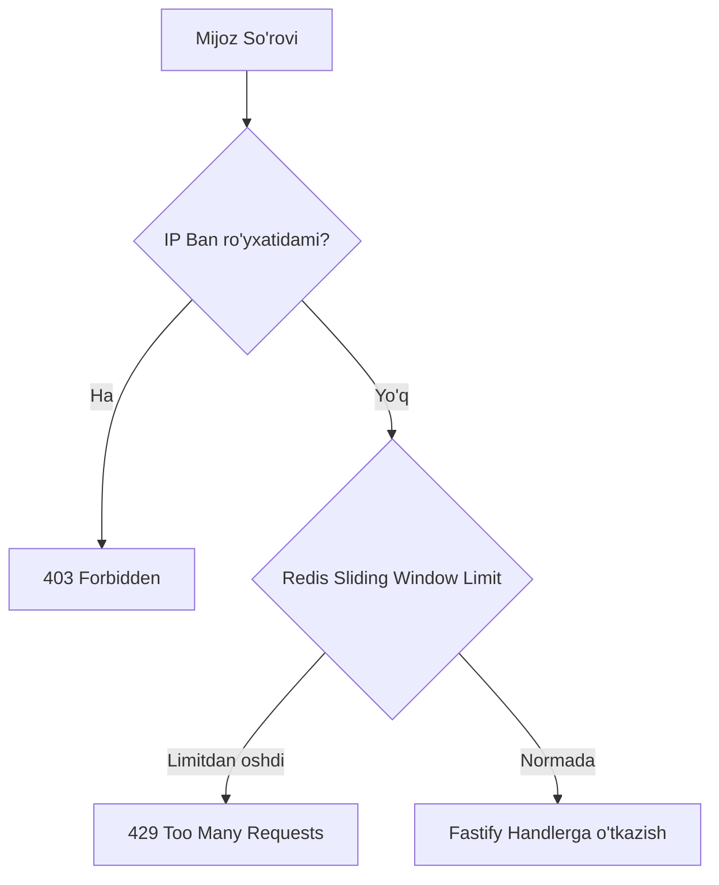

# 🔒 Russian Checkers Platform — Security & Compliance Specification

Hujjat versiyasi: `1.0.0`  
Holati: `Approved / Security Standard`  
Standartlar: `STRIDE Threat Model`, `OWASP Top 10 API Security`, `Telegram Mini Apps Security Best Practices`

---

## 1. Xavfsizlik modeli va Tahdidlar tahlili (STRIDE Threat Model)

Russian Checkers platformasi ko'p o'yinchili real-vaqt tizimi bo'lganligi sababli, uning asosiy xavfsizlik arxitekturasi **STRIDE** modeli asosida tahlil qilingan va himoya mexanizmlari joriy etilgan.

| STRIDE Tahdidi | Xavf tavsifi | Tizimdagi ehtimoliy nuqta | Qo'llangan himoya chorasi (Mitigation) |
| :--- | :--- | :--- | :--- |
| **Spoofing (Shaxsni soxtalashtirish)** | Hujumchi boshqa foydalanuvchining nomidan tizimga kirishi yoki Telegram ID sini o'zgartirishi. | Telegram `initData` kirish nuqtasi. | Bot Token asosida hisoblangan **HMAC-SHA256** kriptografik imzosini har bir kirishda tekshirish. Imzosiz hech qanday ma'lumot qabul qilinmaydi. |
| **Tampering (Ma'lumotlarni buzish / Cheat)** | Klient ilovasini (JS kodini) buzib, toshlarni qoidaga zid surish yoki o'yin hisobini soxtalashtirish. | WebSocket orqali keluvchi `game:move` hodisalari. | **Server-Authoritative Game Engine**: Klient faqat yurish niyatini jo'natadi, qoidalar serverda `packages/game-engine` orqali to'liq qayta tekshiriladi. |
| **Repudiation (Inkor etish)** | Yutqazayotgan o'yinchining partiyani tan olmasligi yoki qasddan tarmoqni uzib qochishi. | Aloqa uzilishi (disconnect). | **45s Grace Period + Forfeit Logic**: Agar o'yinchi 45 soniyada qaytmasa, server unga texnik mag'lubiyat yozadi va reytingini tushiradi. Barcha harakatlar `GameMove` jadvaliga yozib boriladi. |
| **Information Disclosure (Ma'lumotlar oshkor bo'lishi)** | Begona shaxslarning bot tokeni, DB paroli yoki foydalanuvchi ma'lumotlarini qo'lga kiritishi. | API javoblari, xatolik loglari, `.env`. | Telegram Bot Token faqat server muhitida saqlanadi. API javoblarida parollar yoki maxfiy kalitlar chiqarilmaydi. TLS 1.3 shifrlash majburiy. |
| **Denial of Service (DoS / Xizmatdan to'xtatish)** | Serverga minglab soxta so'rovlar yoki WebSocket xabarlari yog'dirib, o'yinlarni to'xtatib qo'yish. | REST API va Socket.IO serveri. | **Redis Sliding Window Rate Limiting**: REST so'rovlari 100 req/min, WS yurishlari maksimal 3 move/sec bilan cheklangan. |
| **Elevation of Privilege (Huquqlarni noqonuniy oshirish)** | Oddiy o'yinchining admin paneli yoki ban funksiyalariga kirishga urinishi. | `/api/v1/admin/*` yo'llari. | Qat'iy **RBAC (Role-Based Access Control)**: Faqat `ADMIN` roliga ega bo'lgan va xavfsiz Telegram ID lari ro'yxatida mavjud foydalanuvchilar kira oladi. |

---

## 2. Autentifikatsiya va Avtorizatsiya (Authentication & RBAC)

### 2.1. Telegram `initData` Kriptografik Validatsiyasi

Telegram Mini App ochilganda, Telegram klienti orqali maxsus `initData` qatori uzatiladi. Ushbu qator quyidagi qat'iy matematik qoidalar bo'yicha serverda tekshiriladi:

```typescript
import crypto from "node:crypto";

export function verifyTelegramInitData(rawInitData: string, botToken: string): { isValid: boolean; user?: any } {
  const urlParams = new URLSearchParams(rawInitData);
  const hash = urlParams.get("hash");

  if (!hash) return { isValid: false };

  // 1. 'hash' kalitini olib tashlab, qolgan parametrlarni alifbo bo'yicha tartiblash
  urlParams.delete("hash");
  const dataCheckString = Array.from(urlParams.entries())
    .map(([key, value]) => `${key}=${value}`)
    .sort()
    .join("\n");

  // 2. Maxfiy kalitni hosil qilish: HMAC-SHA256("WebAppData", botToken)
  const secretKey = crypto
    .createHmac("sha256", "WebAppData")
    .update(botToken)
    .digest();

  // 3. Imzoning nazorat xeshini hisoblash: HMAC-SHA256(secretKey, dataCheckString)
  const calculatedHash = crypto
    .createHmac("sha256", secretKey)
    .update(dataCheckString)
    .digest("hex");

  // 4. Doimiy vaqtli taqqoslash (Timing attack prevention)
  const isHashValid = crypto.timingSafeEqual(
    Buffer.from(calculatedHash, "hex"),
    Buffer.from(hash, "hex")
  );

  if (!isHashValid) return { isValid: false };

  // 5. Eskirish muddatini tekshirish (Replay Attack Prevention)
  const authDate = Number.parseInt(urlParams.get("auth_date") || "0", 10);
  const currentTime = Math.floor(Date.now() / 1000);
  const MAX_AGE_SECONDS = 86400; // 24 soat

  if (currentTime - authDate > MAX_AGE_SECONDS) {
    return { isValid: false }; // Token eskirgan
  }

  const userJson = urlParams.get("user");
  const user = userJson ? JSON.parse(userJson) : null;

  return { isValid: true, user };
}
```

### 2.2. RBAC (Rollar va Ruxsatlar modeli)

Tizimda 3 ta foydalanuvchi roli mavjud:

1. **USER (Oddiy o'yinchi)**:
   - Partiyalarda qatnashish, do'stlar bilan o'ynash, do'kondan skinlar xarid qilish, o'z profilini ko'rish.
2. **MODERATOR (Hakam / Moderator)**:
   - Foydalanuvchilar shikoyatlarini (reports) ko'rish, o'yin tarixini tahlil qilish, shubhali akkauntlarga ogohlantirish berish.
3. **ADMIN (Platforma administratori)**:
   - Tizim statistikasi, foydalanuvchilarni bloklash (Ban/Unban), tangalar balansini tuzatish, tizim konfiguratsiyasini boshqarish.

---

## 3. Kiruvchi ma'lumotlarni qat'iy tekshirish (Input Validation)

### 3.1. Zero-Trust Tamoyili
Server tashqi mijozdan (hatto u autentifikatsiyadan o'tgan bo'lsa ham) keladigan hech bir ma'lumotga ishonmaydi.

### 3.2. REST API Schemasi (Fastify + TypeBox)
Barcha REST so'rovlari oldindan belgilangan JSON schema orqali qattiq tekshiriladi. Noma'lum maydonlar darhol o'chirib tashlanadi (`additionalProperties: false`), noto'g'ri tiplar rad etiladi.

### 3.3. SQL Injection himoyasi
PostgreSQL bilan barcha o'zaro aloqalar **Prisma ORM** orqali amalga oshiriladi. Barcha parametrlar avtomatik ravishda tayyorlangan iboralar (Prepared Statements) orqali yuboriladi, bu esa SQL Injection xavfini butunlay yo'q qiladi.

---

## 4. O'yin adolati va Anti-Cheat tizimi (Fair Play Engine)

### 4.1. Server-Side Move Validation
O'yinchi toshni harakatlantirganda quyidagi qat'iy tekshiruvlar amalga oshiriladi:
1. Navbat o'yinchiga tegishlimi (`currentTurn === playerColor`)?
2. Boshlang'ich katakda o'yinchining toshi bormi?
3. Rus shashkasi qoidalariga ko'ra urish (zarba) mavjudmi?
   - Agar biror toshda urish imkoniyati bo'lsa, o'yinchi oddiy toshni surishga haqli emas (`CAPTURE_MANDATORY`).
4. Uchar damka sakrashi qoidalarga mosmi (yo'lda bittadan ortiq tosh yo'qmi, turkcha zarba qoidasi buzilmaganmi)?

### 4.2. Cheat Engine (Bot yordamchilari)ni aniqlash
Foydalanuvchilar brauzer orqali kompyuter dvigatellaridan (shashka engine) foydalanishining oldini olish uchun quyidagi telemetriya choralari ko'rilgan:
- **Move Latency Profiling**: Har bir yurishga sarflangan vaqt (ms) yozib boriladi.
- Agar o'yinchi murakkab vaziyatlarda doimiy ravishda bir xil (masalan, 1.8 - 2.2 soniya) qisqa vaqtda Stockfish/Checkers engine tavsiya qilgan 1-darajali yurishlarni qilsa, akkaunt tizim tomonidan belgilab qo'yiladi (`suspicious_flag = true`) va admin tekshiruviga yuboriladi.

---

## 5. Rate Limiting va DDoS Himoyasi

### 5.1. Cheklovlar jadvali (Limits Architecture)



- REST so'rovlari: har bir foydalanuvchi/IP uchun 60 soniyada maksimal 100 ta so'rov.
- Auth so'rovlari: 60 soniyada maksimal 10 ta login urinishi.
- WebSocket Move hodisasi: 1 soniyada maksimal 3 ta yurish urinishi.

---

## 6. Ma'lumotlar xavfsizligi va Maxfiylik (Data Privacy & Compliance)

1. **Parolsiz Tizim (Passwordless Security)**:
   - Platformada hech qanday parol saqlanmaydi. Foydalanuvchilar faqat rasmiy Telegram identifikatori orqali kiradi.
2. **Minimal Shaxsiy Ma'lumotlar (PII Minimalism)**:
   - Foydalanuvchining faqat ochiq profili (Telegram ID, first_name, username, avatar) saqlanadi. Telefon raqami yoki xabarlar o'qilmaydi va saqlanmaydi.
3. **Transport darajasidagi shifrlash**:
   - Barcha trafik (REST va WebSocket) faqat TLS 1.2 va TLS 1.3 protokollari orqali shifrlangan holda uzatiladi.
4. **Zaxira nusxalarini shifrlash**:
   - Ma'lumotlar bazasining kunlik zaxira nusxalari (Backups) saqlashdan oldin GPG/AES-256 bilan shifrlanadi.

---

## 7. Xavfsizlik auditi va Hodisalarni qayd etish (Security Audit Logging)

Tizimdagi barcha muhim hodisalar strukturalashgan JSON formatida xavfsiz log fayllariga yozib boriladi:

```json
{
  "timestamp": "2026-11-01T15:20:10.124Z",
  "level": "WARN",
  "eventType": "ILLEGAL_MOVE_ATTEMPT",
  "userId": "usr_clx109283019",
  "gameId": "gm_7730129",
  "ip": "198.51.100.42",
  "details": {
    "attemptedMove": "c3-d4",
    "requiredCapture": "c3:e5",
    "reason": "CAPTURE_MANDATORY"
  }
}
```

### Audit qilinadigan hodisalar ro'yxati:
- Noto'g'ri Telegram initData xeshi bilan kirish urinishlari.
- Qoidaga zid yurishlar (Illegal moves) va noqonuniy paket yuborishlar.
- O'yinchining to'satdan qochib ketishi (Abandonment).
- Administrator tomonidan amalga oshirilgan barcha harakatlar (foydalanuvchini bloklash, balans o'zgartirish).
- Rate limit chegarasidan oshib ketgan IP manzillar.
